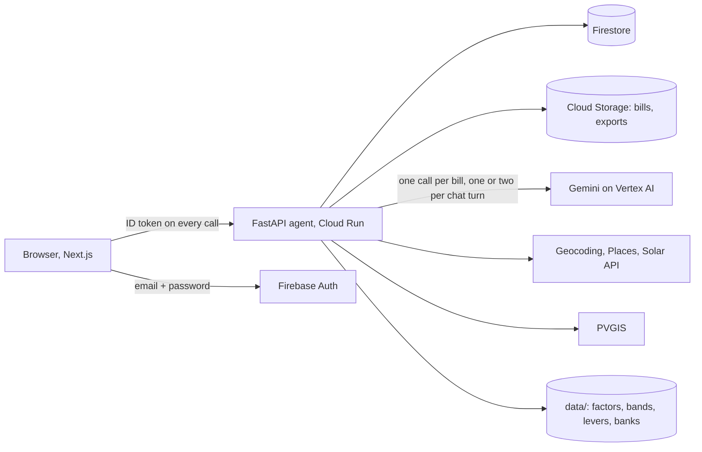

# Technicals

The short version: **the model reads and phrases; code decides and computes.** Gemini turns a photo into a typed
record and turns a question into a sentence. Every number, every factor choice, every check and every cell written
into a questionnaire is deterministic Python that can be unit-tested. That one rule gives both the speed (few model
calls) and the trust (every figure can be traced). It is built end to end on Google's stack (section 2): Gemini on Vertex
AI, ADK, Cloud Run, Firebase, Firestore, Cloud Storage and the Solar, Geocoding and Places APIs.

## 1. Shape



The agent holds no state between requests: lines, issues, assumptions and chat live in Firestore under the supplier, so
a restart or a second device resumes where it stopped. The supplier's Firebase uid is the Firestore document id
(`agent/app/auth.py`), so one supplier can never address another's data.

## 2. The Google stack, end to end

We used Google Cloud and Firebase for every layer where a Google service exists, each doing one clear job. Nothing
here is decoration: remove any one and a feature stops.

| Google service | What it does in NetZero | Where |
|---|---|---|
| **Gemini 3.5 Flash-Lite on Vertex AI** (global endpoint) | Reads every bill (photo, scan, PDF, handwriting) into a strict schema with a box around each figure; phrases the follow-up question; maps a customer's question wording to our fields | [`agents/extractor.py`](agent/app/agents/extractor.py), [`gemini.py`](agent/app/gemini.py), [`agents/filler.py`](agent/app/agents/filler.py) |
| **Google ADK** (Agent Development Kit) | Runs the reconciler agent whose only tools record a resolution against the pending issue | [`agents/reconciler.py`](agent/app/agents/reconciler.py) |
| **google-genai SDK** | One client for every model call: structured output (`response_schema`), Vertex mode with Application Default Credentials, a rate limiter and an on-disk cache | [`gemini.py`](agent/app/gemini.py) |
| **Google Solar API** (building insights) | Measures the real roof: area, panel layouts and yearly kWh, so solar is sized to the site, not guessed | [`solar.py`](agent/app/solar.py), [`advisor.py`](agent/app/advisor.py) |
| **Google Geocoding API** | Turns the site address into coordinates for the Solar API and PVGIS | [`solar.py`](agent/app/solar.py) |
| **Google Places API (New)** | Address suggestions as the supplier types, with session tokens so billing is per search, Essentials fields only | [`solar.py`](agent/app/solar.py) |
| **Firebase App Hosting** | Builds and serves the Next.js web app from the repository | [`web/apphosting.yaml`](web/apphosting.yaml) |
| **Cloud Run** | Runs the FastAPI agent, scaled to zero when idle | [`infra/deploy.sh`](infra/deploy.sh) |
| **Cloud Build and Artifact Registry** | Build the agent image on every deploy and store it | [`infra/cloudbuild.yaml`](infra/cloudbuild.yaml) |
| **Firebase Authentication** | Email and password sign-in; sign-up disabled; the uid becomes the supplier id, so ownership is structural | [`auth.py`](agent/app/auth.py) |
| **Cloud Firestore** | Lines, issues, assumptions, chat and inventory snapshots, so a restart or a second device resumes exactly | [`repo.py`](agent/app/repo.py), [`infra/firestore.rules`](infra/firestore.rules) |
| **Cloud Storage** | Uploaded bills and generated files, served through signed links | [`storage.py`](agent/app/storage.py), [`infra/storage.rules`](infra/storage.rules) |
| **Secret Manager** | API keys, read by the service account, never in code, logs or the browser | [`infra/deploy.sh`](infra/deploy.sh) |
| **IAM, service accounts and Workload Identity Federation** | The agent runs as its own service account; GitHub Actions deploys with no key files | [`.github/workflows/deploy.yml`](.github/workflows/deploy.yml) |
| **Cloud Logging** | The agent's request log, used to verify a live deploy | [`infra/deploy.sh`](infra/deploy.sh) |
| **Firebase Emulator Suite** | The same Auth and Firestore locally, so development and tests need no cloud account | [`scripts/dev.sh`](scripts/dev.sh) |

One data source is not Google: **PVGIS** (EU Joint Research Centre) is the solar fallback where Google's Solar API has
no roof coverage (Vietnam is one such place), so the product still gives an estimate there and says it is one.

## 3. The range of bills it reads

Reading the bills suppliers actually have is the core of the product, so the extractor is built for range, not for a
template. One model call reads a bill into the same schema whatever its language or layout:

- **Languages:** Japanese, Vietnamese and English, read directly. Dates in other calendars (Japanese Reiwa-era
  dates) are normalised.
- **Formats:** PNG, JPG and PDF, singly or as a zip; the zip is unpacked in the browser into the same four-wide queue.
- **Digital and paper:** printed bills, phone photos at an angle, a scan fed in sideways, a low-resolution fax, and
  hand-written slips on pre-printed forms.
- **Shapes:** electricity with several meter registers (day and night); city gas in m3 over two months; diesel,
  petrol, kerosene and LPG in litres, kilograms or cans; refrigerant fill certificates; periods that straddle the
  reporting year, which are cut day by day.
- **Surges and odd months:** the season check compares a month with the carrier's own pattern; the price check holds
  amount per unit against a cited range; both turn into a question, not a silent change.
- **Printing mistakes and misreads:** meter readings times multiplier must reproduce the printed quantity; a stray
  digit fails the index check and the supplier is shown a suggested correction.
- **Duplicates and gaps:** the same bill photographed twice is counted once; a missing month in a periodic carrier is
  asked about.

Evidence: 80 labelled synthetic bills (31 Vietnamese, 42 Japanese, 7 Australian) drawn in the style of EVN, Chubu
Electric Power Miraiz, Toho Gas, SA Power Retail and local fuel dealers. The full 31-bill Japanese year (zip, PDFs, photos,
a sideways scan, a fax, hand-written slips, a misprint, a missing month, a duplicate) is read 31 of 31 correctly; see
[EVALUATION.md](EVALUATION.md) for all measured numbers.

## 4. What the model does, and what it never does

| Model (Gemini) | Code (Python) |
|---|---|
| Reads a bill into a strict schema: lines, units, period, meter registers, printed amount, a box around each figure ([`agents/extractor.py`](agent/app/agents/extractor.py)) | Normalises units, drops duplicates, cuts periods to the fiscal year, finds missing months ([`reconcile_tools.py`](agent/app/reconcile_tools.py)) |
| Phrases one question about the gap, in the supplier's language ([`agents/reconciler.py`](agent/app/agents/reconciler.py)) | Decides which gap to ask about, records the answer as an assumption |
| Maps the wording of a buyer's question to one of our fields ([`agents/filler.py`](agent/app/agents/filler.py)) | Finds where each answer goes in the sheet ([`agents/harvest.py`](agent/app/agents/harvest.py)), computes the value ([`facts.py`](agent/app/facts.py)), writes it |
| Nothing else | Picks the emission factor ([`factor_library.py`](agent/app/factor_library.py)), multiplies ([`calculator.py`](agent/app/calculator.py)), sizes solar ([`advisor.py`](agent/app/advisor.py)), fills the VSME file ([`vsme.py`](agent/app/vsme.py)) |

The extractor copies quantities from the document and is told never to derive them from amounts. A quantity the
model gets wrong is caught by checks that need no model (section 7).

## 5. How latency stays at a few seconds

Where the seconds go, and what we did about each:

| Lever | Effect | Where |
|---|---|---|
| **One model call per bill**, strict `response_schema`, no tool loop; a retry only on a transient 503 or 429 | A bill costs one round trip, not a conversation | [`agents/extractor.py`](agent/app/agents/extractor.py), [`gemini.py`](agent/app/gemini.py) |
| **Four bills in flight at once** from the browser; a zip is unpacked client-side into the same pool | A 31-bill year is bounded by the slowest quarter of the work, not the sum | [`documents/page.tsx`](web/src/app/r/[rid]/documents/page.tsx) (`PARALLEL = 4`), [`lib/bill-files.ts`](web/src/lib/bill-files.ts) |
| **Flash-Lite on Vertex AI**, global endpoint | Fast model, no free-tier 503s; a Vertex call measured at 2.6 s | `GEMINI_MODEL`, `GOOGLE_GENAI_USE_VERTEXAI` in [`settings.py`](agent/app/settings.py) |
| **No model in the maths path**: checks, reconcile `prepare()`, factor choice, inventory, advisor, packs, VSME | Compute and export are milliseconds of Python | [`checks.py`](agent/app/checks.py), [`calculator.py`](agent/app/calculator.py) |
| **One or two model calls per chat turn**; the first question of a session is one call | A reply never waits on a chain of agents | [`agents/reconciler.py`](agent/app/agents/reconciler.py) |
| **On-disk Gemini response cache** keyed on model, prompt, file bytes and schema, plus a client-side RPM/RPD limiter | A re-run, a test and a demo cost no quota and return instantly; a batch never trips a 429 storm | [`gemini.py`](agent/app/gemini.py) |
| **Cached Solar, Geocoding and PVGIS responses**; API keys added to the request only, never to a cache key or log | Repeat advisor views are free and fast | [`solar.py`](agent/app/solar.py) |
| **Evidence rendered on demand**, one page at a time, as an image | "Show bill" does not wait for a whole PDF | [`evidence.py`](agent/app/evidence.py) |

Measured (details in [EVALUATION.md](EVALUATION.md)): the 31-bill Japanese pack reads in 6 to 7 s on the live app (timed by hand, drop to last file); one Vertex call
about 2.6 s. Cloud Run is scaled to zero between uses (`--min-instances 0`, [`infra/deploy.sh`](infra/deploy.sh)), so
the first request after a quiet period pays a cold start; that is a cost decision, not a design limit.

## 6. Grounding and citing: the chain behind every number

Each figure in the product carries its whole lineage as data, not as prose written afterwards.

```
document (stored upload)
  -> ActivityLine   quantity, unit, period, vendor, amount, checks[], quantity_box, page      models.py
  -> Assumption     every answer the supplier gave in chat or an edit, applied to line ids    models.py
  -> FactorChoice   factor row + why it was chosen (year, region, fallback)                   factor_library.py
  -> InventoryLine  quantity x factor = kgCO2e, with factor_id, source_name, source_url,
                    vintage, country, region, year, exact_year, exact_region, fell_back_to    calculator.py
  -> Fact           the value a question asks for, computed once from inventory lines         facts.py
  -> answer         a cell in the buyer's sheet, a pack row, a VSME named range, a PDF line
```

What makes it citable rather than merely logged:

- **The box.** The extractor returns `quantity_box`, where the printed figure sits on its page (0..1000 scale). The
  inventory's "show bill" renders that page and highlights the box ([`evidence.py`](agent/app/evidence.py),
  [`web/src/lib/evidence.ts`](web/src/lib/evidence.ts)). The methodology PDF crops the same box.
- **The factor.** Every factor row in `data/factors/*.csv` has `source_name`, `source_url`, `vintage`, geography and
  year. `FactorChoice.explanation()` turns the choice into a sentence ("2022 factor used as nearest available
  vintage for 2024", "market-based method fell back to location per Scope 2 hierarchy"), stored on the line.
- **The arithmetic.** An inventory line holds quantity, unit, factor value and result, so the drill-down shows
  `quantity x factor = kg` with nothing hidden.
- **One place for each number.** [`facts.compute_fact`](agent/app/facts.py) feeds the Excel filler, the answer
  packs and the VSME writer, so the same figure cannot differ between a customer's sheet, a portal pack and the
  methodology note.
- **Flagged, not guessed.** A fact that does not exist (a reduction target nobody stated, a customer share the
  buyer never gave, a renewable share no bill carries) comes back flagged with the reason and is left for a human.
  A question we cannot answer from bills reads "Answer in the portal".
- **Chat answers are recorded.** Every answer becomes an `Assumption` with the question, the answer and the line ids
  it applies to; the methodology note lists them.
- **Reductions cite too.** Each lever in [`data/levers/levers.csv`](data/levers/levers.csv) has a source, and the
  solar option says whether its figures are Google's roof model or a PVGIS estimate ([`advisor.SOLAR_SOURCES`](agent/app/advisor.py)).

## 7. Self-checks on a bill

A misread digit is the commonest way a small supplier's number goes wrong, and the bill often contains enough to
disprove itself ([`checks.py`](agent/app/checks.py), pure functions, silence is never a pass):

- **index**: meter readings and multiplier must reproduce the printed quantity (0.5 % or one unit).
- **price**: amount divided by quantity must fall inside a cited plausibility band in
  [`data/price_bands/price_bands.csv`](data/price_bands/price_bands.csv), applied only when a bill has a single
  energy line so an invoice total is never misread as a unit price.
- **season**: a month far from the carrier's own pattern ([`reconcile_tools.py`](agent/app/reconcile_tools.py)).

A failed check becomes a question to the supplier, with a suggested corrected quantity, not a silent edit.

## 8. Questionnaires without a model writing numbers

- **The buyer's own Excel**: [`harvest.py`](agent/app/agents/harvest.py) reads the sheet's shape per row (unit
  column, merged cells, header naming the answer column, answer box below, dropdowns); the model only maps wording
  to a field; code writes the number, adds a cell comment with the source and highlights what is left for a human.
- **Portal questionnaires** (CDP SME, EcoVadis, Higg FEM): [`packs.py`](agent/app/packs.py) renders an answer pack
  from a question bank in [`data/questionnaires/`](data/questionnaires) (publisher's numbering and wording, a
  `field`, the evidence to attach). Wording is `verbatim`, `metric_name` or `topic`, so we never present our
  description as a publisher's quotation.
- **EU VSME**: [`vsme.py`](agent/app/vsme.py) patches EFRAG's own Digital Template XML through its named ranges, so
  its dropdowns, protection and XBRL conversion stay intact.

## 9. Auth, secrets and data

- Email and password sign-in only; sign-up is disabled in the Firebase console, so only provisioned accounts exist.
- Every route verifies the Firebase ID token; the uid is the supplier id, so ownership is structural.
- API keys live in Secret Manager and are used server-side only; the Maps key never reaches the browser.
- Bill images and exports are served through signed Cloud Storage links.
- Firestore and Storage rules are in [`infra/`](infra).

## 10. Delivery

A push to `main` runs [`.github/workflows/deploy.yml`](.github/workflows/deploy.yml): tests first, then Cloud Build
and Cloud Run when `agent/`, `data/` or the Dockerfile changed, and Firebase App Hosting when `web/` changed. GitHub
authenticates to Google with Workload Identity Federation, so there are no key files. Environment variables on the
Cloud Run service are set once with `infra/deploy.sh` and persist across deploys.

## 11. Known limits

- Bills in the demo are synthetic; the factor library was transcribed from public sources, and rows marked `VERIFY`
  need a check against the source before a real disclosure.
- Price bands and solar installed costs are analyst estimates, labelled as such in the product.
- Google's Solar API has no coverage in some countries (Vietnam is one); the fallback is an estimate, and says so.
- Generator hours need a rated-consumption assumption before they can be computed, so they are skipped, not guessed.
- Scope 3 is out of scope; the product is a Scope 1 and 2 inventory.
