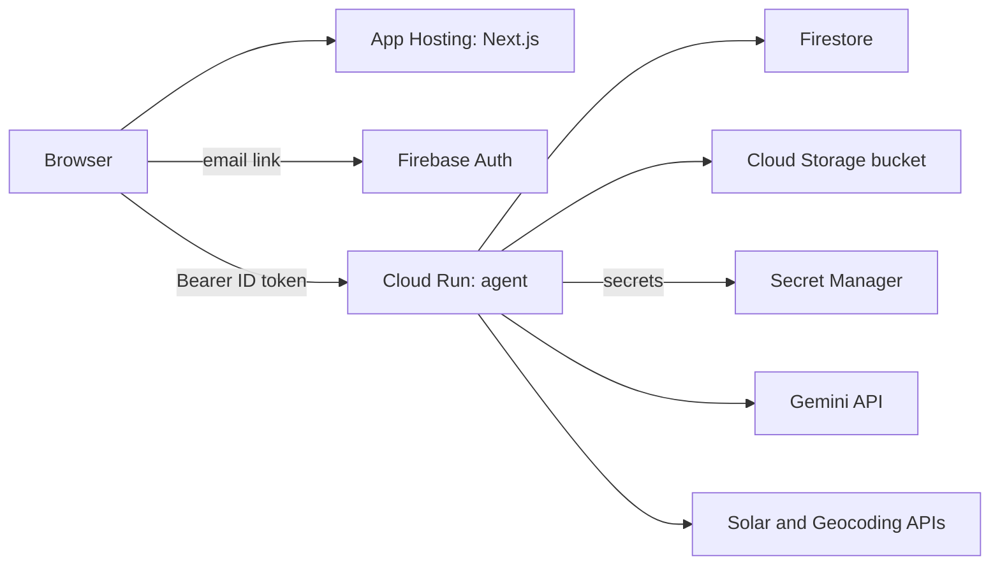
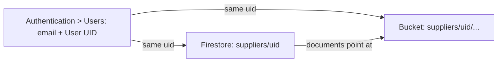

# Manual test plan — local stack, before any deploy

Everything below runs with no cloud account: Firebase emulators, the FastAPI
agent on your laptop, Gemini through an AI Studio key.

## 1. What is running where


Start three terminals from `supplier-carbon/`:

```bash
scripts/dev.sh emulators   # Auth + Firestore emulators, Emulator UI on :4000 (needs Java 21+)
scripts/dev.sh agent       # FastAPI on :8000
scripts/dev.sh web         # Next.js on :3000
```

Sanity: `curl localhost:8000/health` returns
`{"ok":true,"model":"gemini-3.5-flash-lite","vertex":false}`. Open
[http://127.0.0.1:4000](http://127.0.0.1:4000) and keep the Firestore tab visible; every step below
writes something you can watch appear.

Two facts that shape testing:

- The Gemini response cache (`agent/.cache/gemini/`) is keyed on model,
prompt, file bytes and schema. Uploading the same golden PNG a second time
is instant and costs zero quota. To see real model latency and the 15 RPM
pacing, upload a file the cache has never seen (re-save a PNG with a
one-pixel change, or photograph your screen with a phone).
- There is one language setting: the app language (nav, sign-in page or account
menu). It changes the app strings and the language the agent asks its follow-up
questions in (the browser sends it as `X-Locale`). Setup has no language field.
Bills and questionnaires can be in any language, and language never changes a number.

## 2. Scenarios

Files referenced live in `data/golden/rendered/`. Ground truth for every file
is in `data/golden/labels.json`.

### Repeating a scenario

Your email address is your supplier: the Firebase uid is the Firestore
document id, so signing in with the same email always opens the same data,
and the emulator re-imports `emulator-data/` on every start. That is
persistence working (scenario M), but it means "sign in again" is never a
clean slate. Three reset levels, from lightest to heaviest:


| Want to…                                      | Use                                                                              | What goes                                                                                                                                                                                                            | What stays                                                  |
| --------------------------------------------- | -------------------------------------------------------------------------------- | -------------------------------------------------------------------------------------------------------------------------------------------------------------------------------------------------------------------- | ----------------------------------------------------------- |
| Answer the chat differently on the same bills | **Reset questions** (small link on the Questions page, next to "Check my bills") | Conversation, assumptions, inventory, questionnaire results. Activity lines are rebuilt from each bill's stored extraction, so estimated months, hour conversions, exclusions and inline corrections are all undone. | Uploaded bills and their extractions. Zero model calls.     |
| Replay from the upload step                   | **Start over** (bottom of the Company details page, account menu → Company details) | Every reporting year, request, bill, answer and file                                                                                                                                                                  | Company profile                                             |
| Factory-fresh emulator, no suppliers at all   | `scripts/dev.sh reset` (with the emulators stopped)                              | `emulator-data/`, `agent/.local_storage/suppliers/`, e2e screenshots                                                                                                                                                 | Gemini cache, so re-uploading golden bills is still instant |


Backend: `DELETE /suppliers/{uid}/periods/{pid}/data?scope=chat|all` (one
reporting year) and `DELETE /suppliers/{uid}/data` (everything) in
`agent/app/main.py`, implemented by `reset_questions` / `reset_period` /
`reset_all` in `agent/app/services.py`. Same auth as every other route: you
can only reset your own supplier. Resetting a year also drops the filled
questionnaires of every request on that year, because the numbers behind them
are gone; the requests themselves stay.

Note that pressing "Check my bills" again without a reset re-runs the
deterministic checks but keeps the chat history on purpose; if everything is
already resolved it says "done" immediately. Use *Reset questions* when you
want the first question asked again.

For scenario H specifically: upload the 29 VN files once, then loop
*Reset questions → Check my bills → answer* for each of the five answers.
Each loop costs two or three Gemini calls and about 30 seconds.

`+84901234567` is the account the automated e2e scripts use and carries days
of their runs. Either *Start over* on it or pick any other number.

### A0. Landing page

- Steps: open http://localhost:3000 signed out. Expect the floating nav
  (mark, language, Sign in), the serif hero, an expanded inventory-row mock
  showing document → quantity → factor → calculation, four how-it-works
  cards, a trust row and a footer that says the bills are synthetic. Switch
  language in the nav; every string changes. Signed-in users are not
  redirected: the nav button and both calls to action read "Go to your
  dashboard" and lead to `/home`, and the logo links there too.

### A. Sign-in (Auth emulator)

- Steps: `/sign-in`. Type any email and press "Email me a link": the card
  changes to "Check your inbox" with a resend countdown (30 s) and "Use a
  different email". In the emulator no mail is sent: get the link from Emulator
  UI > Authentication, or
  `curl 127.0.0.1:9099/emulator/v1/projects/fir-testing-f96b1/oobCodes` (the `oobLink`),
  and open it in the same browser: a fresh user lands on `/setup`. Opening the
  link in another browser asks you to confirm the address first; reopening a
  used link says it has expired. No reCAPTCHA badge appears anywhere.
- Background: the browser talks to the Auth emulator directly
(`web/src/lib/firebase.ts`). Every API
request carries the ID token; `agent/app/auth.py` verifies it and uses the
uid as the supplier id, so ownership is structural rather than checked per
route.

### B. Profile

- Steps: name `Công ty TNHH Cơ khí Minh Phát`, country Vietnam, FY
  `2025-01-01` to `2025-12-31`, one site `Xưởng Nhơn Trạch`. Leave revenue
  empty for now (scenario J tests the flagged intensity answer). Save: you
  land on `/home`.
- Observe: Firestore `suppliers/{uid}` appears with the site given an auto
  id, and `suppliers/{uid}/periods/{pid}` holds FY2025, created from the FY
  you typed. The FY on the profile is only the default for new years from
  here on; the period is the truth. Re-saving the form keeps site ids stable
  (matched by id, then by name), so bills uploaded earlier stay attached.

### B2. Home and requests

The supplier's mental model is "a customer asked me for numbers", so Home
leads with **requests**. Bills, the conversation and the inventory belong to
a **reporting year** and are shared by every request on that year; only the
questionnaire is the request's own.

- Empty state: an example card ("Aiko Corp (example)", dashed border), an
  "Add your first request" panel and the three trust points. Under it, the
  Reporting years strip shows FY2025 with "0 bills".
- **New request**: name `Aiko Corp`, year FY2025 (preselected; "New year…"
  opens start/end fields), due date `2026-01-31`, share `20`, optional
  `.xlsx`. Create: you land on `/r/{rid}/documents` with the header
  "← Home / Aiko Corp · FY2025" and a four-step stepper where Questions,
  Inventory and Questionnaire show a lock. Locked steps are not links
  (hover shows what unlocks them); going back is always free.
- Add a second request `Toyota Boshoku` on the same year. Both cards show
  "shares the year with 1"; the Bills/Questions/Inventory pages show a
  shared-year notice naming the other customer, and the Remove-bill and
  Reset-questions dialogs warn that the other request's figures change too.
- Add `Old Buyer` on a new year 2024-01-01 → 2024-12-31: a second entry in
  the Reporting years strip with its own empty bills.
- Card anatomy: initials mark, name, template filename if attached, due date
  (amber within 14 days, terracotta and "overdue since" when past), a
  four-segment bar Bills → Questions → Inventory → Filled, "next" step, and
  Start/Continue which opens the request at its next step. The trash icon
  deletes the request and its questionnaire only; the year's bills and
  inventory stay because other requests may use them.
- Gating: after the first bill is read, Questions unlocks; after the chat
  finishes (or an inventory exists), Inventory; after compute, Questionnaire.
  The stepper re-reads progress whenever a page changes it (upload, delete,
  chat done, compute), so you never need to reload.
- Background: `GET /suppliers/{uid}/home` returns periods (document count,
  coverage summary, totals, used-by) and requests with a derived `status`
  (`new|bills|questions|inventory|filled`) and `progress` flags in one call.
  Request status is not stored; it is computed from the period's state and
  whether a questionnaire exists (`period_progress` / `request_status` in
  `agent/app/services.py`).

### C. Upload, happy path

- Steps: on the request's Bills page (`/r/{rid}/documents`) drop or choose all 12 `vn_evn_2025-MM.png`, the 9
  `vn_lpg_*.png` (there is no Jul, Aug, Sep LPG file; that is deliberate), the
  6 `vn_diesel_*.png` and the 2 `vn_refrigerant_*.png`. 29 files.
- **Staging**: nothing uploads yet. A list shows every chosen file with a
  thumbnail and a × to remove it; "Clear list" empties it. Remove one, then
  press "Upload 28 files". Each row shows Waiting → Reading… → Read as the
  model gets to it; the list disappears when done and a toast reports the
  count.
- Observe: each card shows one line: energy type, quantity, unit, period,
  confidence. Compare a few against `labels.json` (`vn_evn_2025-01` = 42,569
  kWh, 2025-01-05 to 2025-02-04). Thumbnails render. Cards are grouped by
  energy type with collapsible headers.
- **Summary card**: "What you have uploaded · 28 bills" lists each energy
  type with bill count, total quantity and, for monthly carriers
  (electricity, LPG), a twelve-cell coverage strip. LPG shows three dashed
  cells (Jul–Sep) and "3 months missing" before you ever reach the chat.
  Diesel and refrigerant say "Deliveries, no monthly coverage".
- **Remove / Read again**: every card has Remove (a confirm dialog, then the
  card animates out, its lines are deleted, the inventory snapshot is dropped
  and the chat goes back to idle). Failed or empty cards also offer "Read
  again", which re-runs extraction on the stored file. Upload the file you
  removed at staging to get back to 29.
- Background: one `POST /suppliers/{uid}/documents` per file. The file is
written to `agent/.local_storage/suppliers/{uid}/uploads/{docId}/`.
`agent/app/agents/extractor.py` sends the image with a Pydantic
`response_schema`, so the model cannot return free text. Firestore gets
`documents/{docId}` (with the raw extraction) and `activityLines/{lineId}`.
Uncached, 29 files take about 2 minutes because of the 15 RPM limiter in
`agent/app/gemini.py`.

### D. Duplicate photo

- Steps: also upload `vn_evn_2025-03_photo_dup.png` (the same bill,
photographed). Both cards read fine. After "Check my bills" (scenario H) the
inventory has exactly one March electricity row; its lineage note reads
"also in document doc_… (duplicate dropped)".
- Background: `dedupe_overlaps` in `agent/app/reconcile_tools.py`: same type,
same site, quantity within 0.5 %, periods overlapping 90 %+. Resolved
silently, never asked about.

### E. PDF instead of image

Upload `vn_evn_2025-01.pdf`. The card shows a PDF badge and the same kWh line.
Same code path, mime `application/pdf`.

### F. Not a bill

Upload any photo (a screenshot, a menu). Expect "Read" with no lines or a
warning, and no inventory row later. The model is told to return an empty
`lines` list when there is nothing to read.

### G. Wrong file type

Rename a `.txt` and upload it. Expect a red 415 error "images and PDFs only".
Over 20 MB gives 413.

### H. Reconciler chat

- **Before pressing anything**: the Questions page opens with "What we
  found · 29 bills, 29 records": one row per energy type with the same
  coverage strips as the documents page, totals, and a legend. After "Check
  my bills" the card gains a footnote line such as "1 duplicate photo dropped
  · 1 bill straddling the year apportioned by days", an "Open items" list
  (LPG Jul–Sep · Asking you now) that ticks off as you answer, and the chat
  opens with a system card "Checked 29 bills · 1 thing to ask you" before the
  first question. This is the deterministic pass made visible; the data
  comes from `summarise()` in `agent/app/reconcile_tools.py`.
- Steps: "Continue to questions", then "Check my bills". Because LPG bills
exist for Jan–Jun and Oct–Dec only, the first (and with the full set, only)
question is in Vietnamese about LPG for 2025-07, 2025-08, 2025-09.
- Try each of these answers, using *Reset questions* between runs (see
"Repeating a scenario" above):
  - `Có, dùng bình thường như các tháng khác.` → `extrapolate_average`: three
  estimated LPG lines with the average monthly kg, one assumption recorded,
  chat says done and links to the inventory.
  - `Không, từ tháng 7 đến tháng 9 xưởng ngừng dùng gas.` → `zero`: three
  estimated lines at 0 kg.
  - `Khoảng 500 kg mỗi tháng.` → `custom_quantity`: three lines at 500 kg.
  - `Đó là bếp của chủ nhà, không phải của chúng tôi.` → `exclude`: LPG lines
  removed from the inventory, assumption says "excluded from boundary".
  - `Tôi không chắc, để tôi hỏi lại kế toán.` → the agent asks again; nothing
  is recorded (check `assumptions` stays empty in Firestore).
- Electricity gap variant: skip `vn_evn_2025-06.png` at upload. You now get a
second question about electricity for 2025-06.
- No-question variant: after answering, press "Check my bills" again. Expect
"done" immediately with the closing sentence, history preserved.
- Not triggerable from the UI with the golden set: `unit_hours` (a generator
log in hours) and `low_confidence` (confidence under 0.7). The clean
synthetic bills read at 1.0. A blurry phone photo of a bill on your screen
is the realistic way to induce low confidence.
- Background: `start()` runs `prepare()` with no model: normalise units,
dedupe, cut periods to the FY, find gaps (only for periodic carriers:
electricity, gas, LPG, steam, cooling; diesel drums and refrigerant top-ups
are lumpy by nature and never gaps). One Gemini call phrases the question.
`reply()` hands your text to an ADK `LlmAgent` whose only tools write the
resolution (`agent/app/agents/reconciler.py`); it cannot invent a number
because the arithmetic is in the tool. State lives in Firestore
`reconcile/state`; `assumptions/{id}` records question, answer, method and
which lines it applied to.
- EVN periods run 5th to 4th. Jan 1–4 is not flagged as a gap (a month needs
10 uncovered days). The December bill straddles into January 2026 and is
apportioned 27/31; the inventory note says so.

### I. Inventory

- **Layout**: four headline stats with share of total and a data-quality
  bar; a monthly chart (Scope 1 black, Scope 2 teal, estimated months amber,
  bills spread over the months they cover by days); a collapsible "How these
  figures were calculated" card with standard, boundary, period, Scope 2
  dual-reporting sentence, tier legend, every emission factor used (value,
  source, geography, vintage, link) and the assumptions; then the table
  grouped by scope and energy type with subtotals, filter chips (energy type,
  tier) and a period/emissions sort. Rows open with a keyboard-operable
  button into a four-step calculation card: source document (thumbnail,
  notes such as "duplicate dropped" or "27/31 days apportioned"), activity
  quantity with tier and why, the factor card (with explicit sentences for
  nearest-vintage, national-fallback and market-fallback), and the
  arithmetic `quantity × factor = kgCO2e = tCO2e`.
- Arriving from a finished chat, compute has already run. Check the four
  headline cards. Location-based Scope 2 for the full EVN set is about
349 tCO2e (529,690 kWh after the December apportionment × 0.6592 kg/kWh, the
VN 2023 grid factor carried to 2025 in `data/factors/vietnam.csv`).
Market-based equals location-based for Vietnam because no residual mix is
published; the lineage text says it fell back to the grid average.
- Scope 1 = diesel 20,100 L × diesel factor + LPG (5,760 kg plus whatever the
gap answer added) × LPG factor + refrigerant kg × GWP (R-410A 1924, R-22
1760, etc. from `data/factors/defra.csv`). The lineage row shows the exact
factor value and citation used, so any row can be checked with a
calculator.
- Click a row: source bill thumbnail (or PDF badge, or "From your answer" for
estimated lines) with filename and id, factor with source and vintage,
market figure, assumptions Q/A with method.
- Inline correction: expand a refrigerant row, "Correct quantity", enter `4`,
  Save, confirm in the dialog (it states old → new and that the tier changes).
  Expect a toast, the Scope 1 headline to change, the row's tier to become
  `secondary`, and the note "corrected by supplier from 3.5 to 4".
Background: `PATCH /activity-lines/{id}` updates the activity line and
re-runs `compute_inventory`, which deletes and rewrites all
`inventoryLines` so totals can never drift from lines.
- Tier mix pills: primary share vs estimated share; estimated exists only if
a gap was filled.

### J. Questionnaire

- Steps: enter customer share `20`, pick
`data/templates/cdp_sme_questionnaire.xlsx`. Expect about 15–17 answers.
Flagged (yellow): Scope 3, reduction target, reduction activities,
intensity per revenue (revenue is empty). Not flagged: Scope 1, Scope 2
location and market, total, electricity MWh, fuel summary, methodology
paragraph, verification status, data quality, allocation (you gave a
share).
- Download and open the xlsx: green cells hold answers, yellow cells read
"NOT PROVIDED — reason", every written cell has a comment "Source: …".
- Go back to Setup, add revenue `50000000000` VND, return and fill again:
  intensity is now answered. (The flagged 20.12a row also carries an inline
  "Add revenue in Setup" link.)
- **What "For you to complete" means**: the filler writes a cell only from a
  fact it has (calculator snapshot, profile, or a templated statement) and
  never guesses. A target, a reduction plan or Scope 3 are not in any bill,
  so those rows are handed back to the owner, and in the workbook they are
  yellow with "NOT PROVIDED — reason" plus the reason in the Notes column,
  which is what the template's own instruction asks for.
- **Editing answers**: every text or flagged row has an *Edit* link under
  it. Edit 20.16 with "Cut Scope 2 by 30 % by 2030 with rooftop solar",
  Save: the pill changes from "For you to complete" to "Answered by you", the
  row turns light blue, source reads "entered by supplier". Edit 20.6
  (methodology, a generated paragraph): source becomes "edited by supplier;
  generated answer was: …" so the original is not lost. Download again and
  open the xlsx: the edited cells are blue with a "Source: entered by
  supplier" comment. Reload the page: edits persist (stored on the
  questionnaire record in Firestore; the workbook is regenerated from the
  stored template on every edit, so download and screen never disagree).
- **Locked rows**: Scope 1, Scope 2 (both), electricity MWh and computed
  intensity show "From your bills — correct the quantity in the inventory"
  instead of Edit. Typing over a calculator number here would break the
  document → factor → cell lineage, so the fix is the inline correction in
  scenario I followed by "Fill it in" again. Trying the PATCH directly
  returns 400.
- The share you gave when creating the request is prefilled; a template
  attached at creation shows "Attached to this request: …" with a "Fill the
  attached questionnaire" button, so the last step can be one click.
- Negative cases: a request whose year has no inventory yet gets
  "compute the inventory first" (409). An xlsx with no question-like text
  gives 422.
- Background: `agent/app/agents/filler.py` harvests question cells with
  openpyxl, makes one structured Gemini call to map each question to a fixed
  field enum, then code writes every number from the snapshot. The model
  never produces a figure. Edits go through
  `PATCH /suppliers/{uid}/questionnaire/{qid}/answers/{question_id}` and
  `write_answers()` rewrites the workbook from the stored answers.
- **How realistic is the template?** `cdp_sme_questionnaire.xlsx` is our
  reconstruction (`agent/scripts/make_cdp_template.py`) of the 2026 CDP SME
  climate data points (20.4–20.17) laid out as a procurement team would send
  them, not CDP's own file; real CDP SME is answered on CDP's portal. Its
  length is faithful for the CDP case. Bespoke buyer sheets (a Japanese
  OEM's 調査票, an EcoVadis-style form) are usually longer, 25–60 rows, and
  ask for things outside the current field enum: renewable-electricity
  share, per-site energy, Scope 3 by category, SBTi status, governance.
  The pipeline accepts any xlsx, but those rows will map to the nearest
  field or be flagged. A longer bespoke template is a pending test asset.

### K. Methodology PDF

"Download methodology". Expect a PDF with narrative sections, a factor table
with sources and vintages, and the assumptions list. Rendered with Jinja2 →
xhtml2pdf (WeasyPrint if installed). Stored at
`outputs/methodology-note.pdf`.

### L. Language

Open the account menu (top right, shows your email) and switch to Tiếng
Việt and 日本語; all strings change, data does not. The same menu holds Sign
out. The reconcile questions are asked in the language the app is showing:
switch to 日本語 and start a fresh reconcile to see Japanese questions.

### M. Persistence

Sign out and back in with the same number: the dashboard lists the same
requests and every year's inventory is still there. Kill and
restart the agent: still there (Firestore, not process memory). Stop the
emulators with Ctrl-C and restart: still there because `dev.sh` exports to
`emulator-data/` on exit. `kill -9` the emulator and you lose the session;
that is the emulator, not the app.

### N. Agent down

Stop the agent, reload `/home`: an error card with "Try again", not a
spinner. Start the agent, press Try again: recovers.

### O. Isolation

Sign in with a second number. Empty state; no trace of the first supplier. In
devtools, replay a request with the first uid in the path: 403.

### P. Phone on the same Wi-Fi (optional)

The Network URL printed by Next.js loads, but the app fails because
`NEXT_PUBLIC_AGENT_URL` is `localhost:8000`, `CORS_ORIGINS` is
`localhost:3000`, and the auth emulator host is hard-coded to
`127.0.0.1:9099`. Real phone testing locally needs those three set to the LAN
IP; simpler is Chrome device mode at 430 px, which is what the e2e scripts
use.

### Q. Quota and outages

`agent/.cache/gemini/_quota.json` shows today's request count against 500.
Past that, uploads show as "failed" with a QuotaExhausted message rather than
hanging. The free tier also returns `503 UNAVAILABLE ("high demand")` for
stretches of an evening; the client retries once after 4 s and then surfaces
the error on the page (red alert on Questions, "Could not read" with "Read
again" on a bill). Extraction of the golden set is cached, so uploads keep
working during an outage; the chat and a first questionnaire fill do not.

### Q2. Keyboard and screen reader

Tab through any page: every control shows a teal focus ring; inventory rows
open with Enter/Space on the period button (`aria-expanded`); dialogs trap
focus and close on Escape, returning focus to the trigger; toasts are
announced via `aria-live`; coverage strips and charts carry text labels so
colour is never the only signal.

### R. Automated checks to run alongside

```bash
cd agent
.venv/bin/pytest                                  # calculator, factors, reconcile tools, API; offline
.venv/bin/python -m scripts.eval_extraction       # golden-set accuracy, cached
.venv/bin/python -m scripts.e2e_local             # browser: the whole journey on a fresh supplier (needs the 3 terminals)
.venv/bin/python -m scripts.e2e_local --resume --email you@example.com   # first request on the dashboard, from its inventory step (useful when Gemini is flaky)
.venv/bin/python -m scripts.e2e_edge              # browser: edge cases above
```

## 3. Why Firestore, and how to hold it

Firestore is the only database. Profile, documents, activity lines,
assumptions, inventory lines, chat state and questionnaires all live under
`suppliers/{uid}` (`agent/app/repo.py`). The browser never reads or writes
it; every write goes through the FastAPI agent with the Admin SDK, and
`infra/firestore.rules` denies client writes outright. That is what makes
"every number came from the calculator" a property of the system and not a
convention.

Why not a plain Vercel app:

- The front end could be on Vercel today. Vercel is not the problem.
- The agent cannot be a Vercel function: it is Python with ADK, openpyxl and
PDF rendering, a reconciler turn can take 30 s or more under the free-tier
rate limiter, and it needs a filesystem for the Gemini cache and the local
storage backend. It needs a container host; on this stack that is Cloud
Run.
- Cloud Run instances are stateless and disposable, so state must live
outside them. Firestore over a hosted Postgres because it is in the same
Firebase project as Auth (one SDK, one credential), it is free at this
scale with no connection pooling or migrations, and the submission is
judged as a Google Cloud build.
- Firebase Auth is the real lock-in, not Firestore. Email-link sign-in is the
sign-in, and the Auth emulator is the only way to run it with no card.

The friction is the emulator, not Firestore: the Java dependency, and the
stack failing opaquely when the emulator is not up. Ways to reduce it without
changing the architecture:

- `scripts/dev.sh emulators` starts only Auth and Firestore. The Storage
emulator is not needed because `STORAGE_BACKEND=local` writes to disk.
- `STORAGE_BACKEND=memory` in `.env` swaps in `MemoryRepo`: no Firestore
emulator at all, data gone on agent restart. Fine for quick UI iteration,
useless for the persistence scenarios. You still need the Auth emulator.
- Real Firestore on the Spark plan (no card) works today; the deploy-time move is
Cloud Run and App Hosting, which need the Blaze plan.

Keep the three-terminal habit, watch the Emulator UI at :4000 while testing,
and always stop the emulators with Ctrl-C so the export runs.

## 4. Deploying to Google Cloud, and checking it

Target: the existing Firebase project `fir-testing-f96b1`. The agent runs on Cloud
Run, the web app on Firebase App Hosting, with Firestore, a Cloud Storage bucket,
Secret Manager and email-link Auth around them. Region `asia-southeast1`.



### One-time setup

1. `gcloud auth login` and `firebase login` with the account that owns the trial.
2. Link the trial billing account to the project (needed for Cloud Run, Cloud Build
   and App Hosting): `gcloud billing accounts list`, then
   `gcloud billing projects link fir-testing-f96b1 --billing-account=ACCOUNT_ID`.
3. `infra/deploy.sh setup` enables the APIs (including Solar and Geocoding), creates
   Firestore, the bucket, the Artifact Registry repository and the agent's service
   account, and deploys the Firestore rules.
4. `infra/deploy.sh secrets` copies `GOOGLE_API_KEY` and `GOOGLE_MAPS_API_KEY` from
   your `.env` into Secret Manager. Nothing is printed. In the Cloud console,
   restrict the Maps key to the Solar API and Geocoding API.
5. Firebase console, Authentication > Sign-in method: enable Email/Password and tick "Email
   link (passwordless sign-in)". Under Settings > Authorized domains add your App Hosting
   and custom domains. Under Project settings, set the public-facing name to "Supplier
   Carbon": it is the name in the sign-in email.
6. Set a budget alert (Billing, Budgets and alerts), for example 2,000 INR, so the
   trial credit cannot be spent unnoticed.

### Automatic deploys

A push to `main` runs `.github/workflows/deploy.yml`: tests first, then Cloud Run if `agent/`, `data/`
or the Dockerfile changed, and App Hosting if `web/` changed. Pull requests run the tests only.
GitHub authenticates to Google with Workload Identity Federation (pool `github`, service account
`github-deployer`, trusted only for this repo's `main`), so there are no key files. The two repository
variables `GCP_WIF_PROVIDER` and `GCP_DEPLOYER_SA` hold the identifiers. Watch runs with `gh run list`.
The manual commands below still work for a deploy from your laptop.

### Each deploy

```bash
infra/deploy.sh agent            # Cloud Build, then Cloud Run; prints the agent URL
```

Web: App Hosting deploys straight from local source (no GitHub link needed). The backend
`supplier-carbon-web` already exists; its settings live in `web/apphosting.yaml` and the Firebase
web API key is the Secret Manager secret `firebase-web-api-key`.

```bash
firebase deploy --only apphosting --project fir-testing-f96b1
infra/deploy.sh cors https://supplier-carbon-web--fir-testing-f96b1.asia-southeast1.hosted.app
```

The `cors` step only needs repeating if the web origin changes. `web/pnpm-workspace.yaml` lists the
dependencies allowed to run install scripts; without it the App Hosting build stops on pnpm's
"ignored build scripts" error.

### Current deployment

- Agent: https://supplier-carbon-agent-532444884362.asia-southeast1.run.app
- Web: https://supplier-carbon-web--fir-testing-f96b1.asia-southeast1.hosted.app

### Checking the deployed stack

The browser scripts cannot sign in to the deployed stack unattended: the sign-in link arrives by real
email, while the scripts read it from the Auth emulator. So production is verified by hand, then
confirmed from the logs:

1. Sign in on the deployed site with your own email (the link arrives within a minute; check spam the
   first time) and walk the whole flow: setup, upload bills, reconcile, inventory, questionnaire, reduce.
2. Open a bill from the inventory ("show me where") and download the filled workbook. These go through
   signed Cloud Storage links, the part most likely to differ from local.
3. Read the agent's request log. Every call should be 2xx apart from the 404 a brand-new user gets on
   `GET /suppliers/{uid}` before setup:

```bash
gcloud logging read 'resource.type="cloud_run_revision" AND resource.labels.service_name="supplier-carbon-agent" AND (severity>=WARNING OR httpRequest.status>=400)' \
  --project fir-testing-f96b1 --freshness 1d --limit 20 \
  --format='value(timestamp,severity,httpRequest.status,httpRequest.requestUrl,textPayload)'
```

The scripts still accept `E2E_WEB_URL` and `E2E_AGENT_URL`, but only the emulator hands them a sign-in link.
Differences from local to expect: real Gemini calls (the
response cache is empty on a fresh instance, so the first run spends free-tier quota and is paced at 15
requests a minute), and signed download URLs for bill images and exports.

Run history:
- 2026-10-11, manual run with a real number: upload, reconcile, compute, questionnaire, advisor and
  locate all returned 200. Bill images and downloads returned 500 (`ACCESS_TOKEN_SCOPE_INSUFFICIENT`
  while signing); fixed by signing with the `cloud-platform` scope.


## 5. Where your data lives, and how to look at it

Everything a supplier owns is keyed by their Firebase user id (uid). **There is no email in the
Storage path, and the Firestore document id is the uid, not the email.** The email sits in
Authentication, and it is also copied onto the supplier document as `email` (filled the next time that
user opens the app).



| Question | Where to look |
|---|---|
| Which emails have signed in? | Firebase console > Authentication > Users (https://console.firebase.google.com/project/fir-testing-f96b1/authentication/users). "Identifier" is the email, "User UID" the key, plus created and last sign-in. |
| Whose data is this Firestore row? | The document id under `suppliers` is the uid. Paste it into the Users search box. The `email` field on the document shows the address directly. |
| Whose files are these? | The first folder under `suppliers/` in the bucket is the same uid. |
| What data does an email have? | Copy its User UID, then open `suppliers/<uid>` in Firestore and `suppliers/<uid>/` in the bucket. |

**Firestore** (https://console.firebase.google.com/project/fir-testing-f96b1/firestore/databases/-default-/data):
`suppliers/{uid}` holds the profile (`country`, `language`, `sites`, `email`). Underneath: `requests`,
`questionnaires`, and `periods/{pid}` with `documents`, `activityLines`, `assumptions`, `reconcile/state`,
`inventoryLines` and `inventory/snapshot`. Treat it as read-only; edits bypass the calculator.

**Cloud Storage** (https://console.cloud.google.com/storage/browser/fir-testing-f96b1-bills?project=fir-testing-f96b1,
a plain bucket, not the empty default one on the Firebase Storage tab):
- `suppliers/{uid}/periods/{pid}/uploads/{docId}/<file>`: the bills as uploaded
- `suppliers/{uid}/periods/{pid}/outputs/methodology-note.pdf`
- `suppliers/{uid}/requests/{rid}/template.xlsx` and `.../outputs/{qid}/<name>-filled.xlsx`

From a terminal: `gcloud storage ls -r gs://fir-testing-f96b1-bills/suppliers/`

Also useful:
- Agent logs: https://console.cloud.google.com/run/detail/asia-southeast1/supplier-carbon-agent/logs?project=fir-testing-f96b1
- Web rollouts: https://console.firebase.google.com/project/fir-testing-f96b1/apphosting
- Deploy runs: the repository's Actions tab, or `gh run list`
- Secrets: https://console.cloud.google.com/security/secret-manager?project=fir-testing-f96b1
- Spend: https://console.cloud.google.com/billing

A user who opens the app but never saves Setup has an Authentication entry and no Firestore document
(the agent answers 404 on `GET /suppliers/{uid}` until the first save).

## 6. Custom domain: carbon.siddhantxh.com

The site is reachable at `https://carbon.siddhantxh.com` as well as the App Hosting address.

- **App Hosting** > `supplier-carbon-web` > Settings > Domains holds the domain. DNS is managed in
  Cloudflare for siddhantxh.com: the records Firebase shows (an `A` record for `carbon` and a `fah-claim`
  TXT record) must stay **DNS only** (grey cloud), or certificate issuance and renewal fail.
- **Authentication > Settings > Authorized domains** must list `carbon.siddhantxh.com`.
- **The agent must allow the origin.** CORS is a list, set in one call (it replaces the previous list):
  `infra/deploy.sh cors https://supplier-carbon-web--fir-testing-f96b1.asia-southeast1.hosted.app https://carbon.siddhantxh.com`
- **Sign-in email.** Firebase sends it from its own address with a subject and body it controls. The
  name shown is the project's public-facing name ("Supplier Carbon"); the link points at the site the user
  asked from, so it works on both addresses.

## 7. Languages, countries and sites

- **Language** is one setting, the app language. It changes the app text and the language of the agent's
  follow-up questions. It never changes a number.
- **Country** (Setup) picks the emission factors and the price checks. Only Australia has state-level
  grid factors (NSW, VIC, QLD, SA, WA, TAS), so the state dropdown only appears for Australia; another
  state uses the national figure.
- **Site address** is not asked in Setup. It is entered on the Reduce page, where it is used to find the
  roof for solar. A full address (number, street, district, city, or the lot in an industrial park) or
  coordinates pasted from Google Maps both work. A street-level match is flagged, with a Google Maps
  link to check it.
- **Solar sources.** With Solar API coverage, yearly energy comes from Google's roof model (aerial or
  satellite imagery). Google publishes coverage as a map, not a country list, and it is per building: where
  it has none the API answers 404 and the app uses PVGIS (EU JRC, ERA5 irradiance, global) with the roof
  area the supplier types. Vietnam has no coverage; Japan, Australia, Thailand and Indonesia do. Singapore and
  India are not confirmed, but either way the page works.
