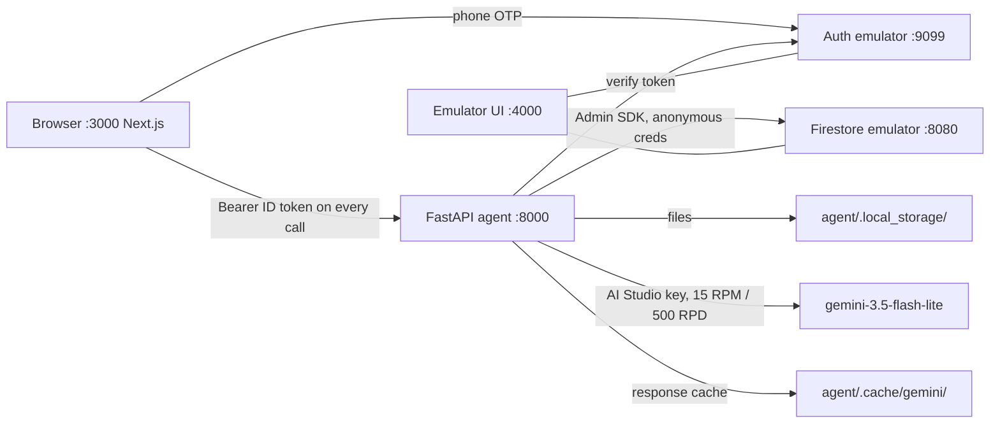

# Manual test plan — local stack, before any deploy

Everything below runs with no cloud account: Firebase emulators, the FastAPI
agent on your laptop, Gemini through an AI Studio key.

## 1. What is running where




Start three terminals from `supplier-carbon/`:

```bash
scripts/dev.sh emulators   # Auth + Firestore emulators, Emulator UI on :4000 (needs Java 21+)
scripts/dev.sh agent       # FastAPI on :8000
scripts/dev.sh web         # Next.js on :3000
```

Sanity: `curl localhost:8000/health` returns
`{"ok":true,"model":"gemini-3.5-flash-lite","vertex":false}`. Open
[http://127.0.0.1:4000](http://127.0.0.1:4000) and keep the Firestore tab visible; every step below
writes something you can watch appear.

Two facts that shape testing:

- The Gemini response cache (`agent/.cache/gemini/`) is keyed on model,
prompt, file bytes and schema. Uploading the same golden PNG a second time
is instant and costs zero quota. To see real model latency and the 15 RPM
pacing, upload a file the cache has never seen (re-save a PNG with a
one-pixel change, or photograph your screen with a phone).
- The agent's chat language comes from the profile `language` you pick at
Setup, not from the UI language switcher. The switcher only changes the app
strings.

## 2. Scenarios

Files referenced live in `data/golden/rendered/`. Ground truth for every file
is in `data/golden/labels.json`.

### Repeating a scenario

Your phone number is your supplier: the Firebase uid is the Firestore
document id, so signing in with the same number always opens the same data,
and the emulator re-imports `emulator-data/` on every start. That is
persistence working (scenario M), but it means "sign in again" is never a
clean slate. Three reset levels, from lightest to heaviest:


| Want to…                                      | Use                                                                              | What goes                                                                                                                                                                                                            | What stays                                                  |
| --------------------------------------------- | -------------------------------------------------------------------------------- | -------------------------------------------------------------------------------------------------------------------------------------------------------------------------------------------------------------------- | ----------------------------------------------------------- |
| Answer the chat differently on the same bills | **Reset questions** (small link on the Questions page, next to "Check my bills") | Conversation, assumptions, inventory, questionnaire results. Activity lines are rebuilt from each bill's stored extraction, so estimated months, hour conversions, exclusions and inline corrections are all undone. | Uploaded bills and their extractions. Zero model calls.     |
| Replay from the upload step                   | **Start over** (bottom of the Setup page)                                        | Everything above plus documents and stored files                                                                                                                                                                     | Company profile                                             |
| Factory-fresh emulator, no suppliers at all   | `scripts/dev.sh reset` (with the emulators stopped)                              | `emulator-data/`, `agent/.local_storage/suppliers/`, e2e screenshots                                                                                                                                                 | Gemini cache, so re-uploading golden bills is still instant |


Backend: `DELETE /suppliers/{uid}/data?scope=chat|all` in `agent/app/main.py`,
implemented by `reset_questions` / `reset_all` in `agent/app/services.py`.
Same auth as every other route: you can only reset your own supplier.

Note that pressing "Check my bills" again without a reset re-runs the
deterministic checks but keeps the chat history on purpose; if everything is
already resolved it says "done" immediately. Use *Reset questions* when you
want the first question asked again.

For scenario H specifically: upload the 29 VN files once, then loop
*Reset questions → Check my bills → answer* for each of the five answers.
Each loop costs two or three Gemini calls and about 30 seconds.

`+84901234567` is the account the automated e2e scripts use and carries days
of their runs. Either *Start over* on it or pick any other number.

### A. Sign-in (Auth emulator)

- Steps: `/sign-in`, enter any Vietnamese number such as `+84901234567`, Send
code. Get the code from Emulator UI > Authentication, or
`curl 127.0.0.1:9099/emulator/v1/projects/fir-testing-f96b1/verificationCodes`.
First enter `000000`: expect an inline error and you stay on the code step.
Then enter the real code: a fresh user lands on `/setup`.
- Background: the browser talks to the Auth emulator directly
(`web/src/lib/firebase.ts`, reCAPTCHA disabled for testing). Every API
request carries the ID token; `agent/app/auth.py` verifies it and uses the
uid as the supplier id, so ownership is structural rather than checked per
route.

### B. Profile

- Steps: name `Công ty TNHH Cơ khí Minh Phát`, country VN, language `vi`, FY
`2025-01-01` to `2025-12-31`, one site `Xưởng Nhơn Trạch`. Leave revenue
empty for now (scenario J tests the flagged intensity answer). Save.
- Observe: Firestore `suppliers/{uid}` appears with the site given an auto id.

### C. Upload, happy path

- Steps: on `/documents` pick all 12 `vn_evn_2025-MM.png`, the 9
`vn_lpg_*.png` (there is no Jul, Aug, Sep LPG file; that is deliberate), the
6 `vn_diesel_*.png` and the 2 `vn_refrigerant_*.png`. 29 files.
- Observe: each card goes "Reading" then "Read" with one line: energy type,
quantity, unit, period, confidence. Compare a few against `labels.json`
(`vn_evn_2025-01` = 42,569 kWh, 2025-01-05 to 2025-02-04). Thumbnails
render.
- Background: one `POST /suppliers/{uid}/documents` per file. The file is
written to `agent/.local_storage/suppliers/{uid}/uploads/{docId}/`.
`agent/app/agents/extractor.py` sends the image with a Pydantic
`response_schema`, so the model cannot return free text. Firestore gets
`documents/{docId}` (with the raw extraction) and `activityLines/{lineId}`.
Uncached, 29 files take about 2 minutes because of the 15 RPM limiter in
`agent/app/gemini.py`.

### D. Duplicate photo

- Steps: also upload `vn_evn_2025-03_photo_dup.png` (the same bill,
photographed). Both cards read fine. After "Check my bills" (scenario H) the
inventory has exactly one March electricity row; its lineage note reads
"also in document doc_… (duplicate dropped)".
- Background: `dedupe_overlaps` in `agent/app/reconcile_tools.py`: same type,
same site, quantity within 0.5 %, periods overlapping 90 %+. Resolved
silently, never asked about.

### E. PDF instead of image

Upload `vn_evn_2025-01.pdf`. The card shows a PDF badge and the same kWh line.
Same code path, mime `application/pdf`.

### F. Not a bill

Upload any photo (a screenshot, a menu). Expect "Read" with no lines or a
warning, and no inventory row later. The model is told to return an empty
`lines` list when there is nothing to read.

### G. Wrong file type

Rename a `.txt` and upload it. Expect a red 415 error "images and PDFs only".
Over 20 MB gives 413.

### H. Reconciler chat

- Steps: "Continue to questions", then "Check my bills". Because LPG bills
exist for Jan–Jun and Oct–Dec only, the first (and with the full set, only)
question is in Vietnamese about LPG for 2025-07, 2025-08, 2025-09.
- Try each of these answers, using *Reset questions* between runs (see
"Repeating a scenario" above):
  - `Có, dùng bình thường như các tháng khác.` → `extrapolate_average`: three
  estimated LPG lines with the average monthly kg, one assumption recorded,
  chat says done and links to the inventory.
  - `Không, từ tháng 7 đến tháng 9 xưởng ngừng dùng gas.` → `zero`: three
  estimated lines at 0 kg.
  - `Khoảng 500 kg mỗi tháng.` → `custom_quantity`: three lines at 500 kg.
  - `Đó là bếp của chủ nhà, không phải của chúng tôi.` → `exclude`: LPG lines
  removed from the inventory, assumption says "excluded from boundary".
  - `Tôi không chắc, để tôi hỏi lại kế toán.` → the agent asks again; nothing
  is recorded (check `assumptions` stays empty in Firestore).
- Electricity gap variant: skip `vn_evn_2025-06.png` at upload. You now get a
second question about electricity for 2025-06.
- No-question variant: after answering, press "Check my bills" again. Expect
"done" immediately with the closing sentence, history preserved.
- Not triggerable from the UI with the golden set: `unit_hours` (a generator
log in hours) and `low_confidence` (confidence under 0.7). The clean
synthetic bills read at 1.0. A blurry phone photo of a bill on your screen
is the realistic way to induce low confidence.
- Background: `start()` runs `prepare()` with no model: normalise units,
dedupe, cut periods to the FY, find gaps (only for periodic carriers:
electricity, gas, LPG, steam, cooling; diesel drums and refrigerant top-ups
are lumpy by nature and never gaps). One Gemini call phrases the question.
`reply()` hands your text to an ADK `LlmAgent` whose only tools write the
resolution (`agent/app/agents/reconciler.py`); it cannot invent a number
because the arithmetic is in the tool. State lives in Firestore
`reconcile/state`; `assumptions/{id}` records question, answer, method and
which lines it applied to.
- EVN periods run 5th to 4th. Jan 1–4 is not flagged as a gap (a month needs
10 uncovered days). The December bill straddles into January 2026 and is
apportioned 27/31; the inventory note says so.

### I. Inventory

- Arriving from a finished chat, compute has already run. Check the four
headline cards. Location-based Scope 2 for the full EVN set is about
349 tCO2e (529,690 kWh after the December apportionment × 0.6592 kg/kWh, the
VN 2023 grid factor carried to 2025 in `data/factors/vietnam.csv`).
Market-based equals location-based for Vietnam because no residual mix is
published; the lineage text says it fell back to the grid average.
- Scope 1 = diesel 20,100 L × diesel factor + LPG (5,760 kg plus whatever the
gap answer added) × LPG factor + refrigerant kg × GWP (R-410A 1924, R-22
1760, etc. from `data/factors/defra.csv`). The lineage row shows the exact
factor value and citation used, so any row can be checked with a
calculator.
- Click a row: source bill thumbnail (or PDF badge, or "From your answer" for
estimated lines) with filename and id, factor with source and vintage,
market figure, assumptions Q/A with method.
- Inline correction: expand a refrigerant row, "Correct quantity", enter `4`,
Save. Expect the Scope 1 headline to change, the row's tier to become
`secondary`, and the note "corrected by supplier from 3.5 to 4".
Background: `PATCH /activity-lines/{id}` updates the activity line and
re-runs `compute_inventory`, which deletes and rewrites all
`inventoryLines` so totals can never drift from lines.
- Tier mix pills: primary share vs estimated share; estimated exists only if
a gap was filled.

### J. Questionnaire

- Steps: enter customer share `20`, pick
`data/templates/cdp_sme_questionnaire.xlsx`. Expect about 15–17 answers.
Flagged (yellow): Scope 3, reduction target, reduction activities,
intensity per revenue (revenue is empty). Not flagged: Scope 1, Scope 2
location and market, total, electricity MWh, fuel summary, methodology
paragraph, verification status, data quality, allocation (you gave a
share).
- Download and open the xlsx: green cells hold answers, yellow cells read
"NOT PROVIDED — reason", every written cell has a comment "Source: …".
- Go back to Setup, add revenue `50000000000` VND, return and fill again:
  intensity is now answered. (The flagged 20.12a row also carries an inline
  "Add revenue in Setup" link.)
- **What "For you to complete" means**: the filler writes a cell only from a
  fact it has (calculator snapshot, profile, or a templated statement) and
  never guesses. A target, a reduction plan or Scope 3 are not in any bill,
  so those rows are handed back to the owner, and in the workbook they are
  yellow with "NOT PROVIDED — reason" plus the reason in the Notes column,
  which is what the template's own instruction asks for.
- **Editing answers**: every text or flagged row has an *Edit* link under
  it. Edit 20.16 with "Cut Scope 2 by 30 % by 2030 with rooftop solar",
  Save: the pill changes from "For you to complete" to "Answered by you", the
  row turns light blue, source reads "entered by supplier". Edit 20.6
  (methodology, a generated paragraph): source becomes "edited by supplier;
  generated answer was: …" so the original is not lost. Download again and
  open the xlsx: the edited cells are blue with a "Source: entered by
  supplier" comment. Reload the page: edits persist (stored on the
  questionnaire record in Firestore; the workbook is regenerated from the
  stored template on every edit, so download and screen never disagree).
- **Locked rows**: Scope 1, Scope 2 (both), electricity MWh and computed
  intensity show "From your bills — correct the quantity in the inventory"
  instead of Edit. Typing over a calculator number here would break the
  document → factor → cell lineage, so the fix is the inline correction in
  scenario I followed by "Fill it in" again. Trying the PATCH directly
  returns 400.
- Negative cases: a brand-new user going straight to `/questionnaire` gets
  "compute the inventory first" (409). An xlsx with no question-like text
  gives 422.
- Background: `agent/app/agents/filler.py` harvests question cells with
  openpyxl, makes one structured Gemini call to map each question to a fixed
  field enum, then code writes every number from the snapshot. The model
  never produces a figure. Edits go through
  `PATCH /suppliers/{uid}/questionnaire/{qid}/answers/{question_id}` and
  `write_answers()` rewrites the workbook from the stored answers.
- **How realistic is the template?** `cdp_sme_questionnaire.xlsx` is our
  reconstruction (`agent/scripts/make_cdp_template.py`) of the 2026 CDP SME
  climate data points (20.4–20.17) laid out as a procurement team would send
  them, not CDP's own file; real CDP SME is answered on CDP's portal. Its
  length is faithful for the CDP case. Bespoke buyer sheets (a Japanese
  OEM's 調査票, an EcoVadis-style form) are usually longer, 25–60 rows, and
  ask for things outside the current field enum: renewable-electricity
  share, per-site energy, Scope 3 by category, SBTi status, governance.
  The pipeline accepts any xlsx, but those rows will map to the nearest
  field or be flagged. A longer bespoke template is a pending test asset.

### K. Methodology PDF

"Download methodology". Expect a PDF with narrative sections, a factor table
with sources and vintages, and the assumptions list. Rendered with Jinja2 →
xhtml2pdf (WeasyPrint if installed). Stored at
`outputs/methodology-note.pdf`.

### L. Language

Switch the header dropdown to Tiếng Việt and 日本語; all strings change, data
does not. Chat language stays whatever the profile says. Create a second
profile with language `ja` to see Japanese questions.

### M. Persistence

Sign out and back in with the same number: everything is there. Kill and
restart the agent: still there (Firestore, not process memory). Stop the
emulators with Ctrl-C and restart: still there because `dev.sh` exports to
`emulator-data/` on exit. `kill -9` the emulator and you lose the session;
that is the emulator, not the app.

### N. Agent down

Stop the agent, reload `/documents`: an error card with "Try again", not a
spinner. Start the agent, press Try again: recovers.

### O. Isolation

Sign in with a second number. Empty state; no trace of the first supplier. In
devtools, replay a request with the first uid in the path: 403.

### P. Phone on the same Wi-Fi (optional)

The Network URL printed by Next.js loads, but the app fails because
`NEXT_PUBLIC_AGENT_URL` is `localhost:8000`, `CORS_ORIGINS` is
`localhost:3000`, and the auth emulator host is hard-coded to
`127.0.0.1:9099`. Real phone testing locally needs those three set to the LAN
IP; simpler is Chrome device mode at 430 px, which is what the e2e scripts
use.

### Q. Quota

`agent/.cache/gemini/_quota.json` shows today's request count against 500.
Past that, uploads show as "failed" with a QuotaExhausted message rather than
hanging.

### R. Automated checks to run alongside

```bash
cd agent
.venv/bin/pytest                                  # calculator, factors, reconcile tools, API; offline
.venv/bin/python -m scripts.eval_extraction       # golden-set accuracy, cached
.venv/bin/python -m scripts.e2e_local             # browser: the whole journey (needs the 3 terminals)
.venv/bin/python -m scripts.e2e_edge              # browser: edge cases above
```

## 3. Why Firestore, and how to hold it

Firestore is the only database. Profile, documents, activity lines,
assumptions, inventory lines, chat state and questionnaires all live under
`suppliers/{uid}` (`agent/app/repo.py`). The browser never reads or writes
it; every write goes through the FastAPI agent with the Admin SDK, and
`infra/firestore.rules` denies client writes outright. That is what makes
"every number came from the calculator" a property of the system and not a
convention.

Why not a plain Vercel app:

- The front end could be on Vercel today. Vercel is not the problem.
- The agent cannot be a Vercel function: it is Python with ADK, openpyxl and
PDF rendering, a reconciler turn can take 30 s or more under the free-tier
rate limiter, and it needs a filesystem for the Gemini cache and the local
storage backend. It needs a container host; on this stack that is Cloud
Run.
- Cloud Run instances are stateless and disposable, so state must live
outside them. Firestore over a hosted Postgres because it is in the same
Firebase project as Auth (one SDK, one credential), it is free at this
scale with no connection pooling or migrations, and the submission is
judged as a Google Cloud build.
- Firebase Auth is the real lock-in, not Firestore. Phone OTP with test
numbers is the demo's sign-in, and the Auth emulator is the only way to run
it with no card.

The friction is the emulator, not Firestore: the Java dependency, and the
stack failing opaquely when the emulator is not up. Ways to reduce it without
changing the architecture:

- `scripts/dev.sh emulators` starts only Auth and Firestore. The Storage
emulator is not needed because `STORAGE_BACKEND=local` writes to disk.
- `STORAGE_BACKEND=memory` in `.env` swaps in `MemoryRepo`: no Firestore
emulator at all, data gone on agent restart. Fine for quick UI iteration,
useless for the persistence scenarios. You still need the Auth emulator.
- Real Firestore on the Spark plan (no card) works today; only Phone Auth is
gated behind Blaze. That is the deploy-time move.

Keep the three-terminal habit, watch the Emulator UI at :4000 while testing,
and always stop the emulators with Ctrl-C so the export runs.